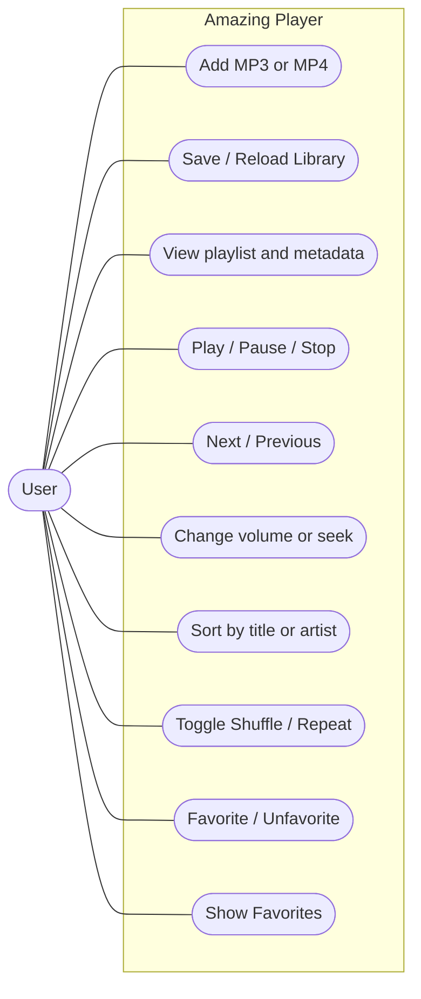

# Use case diagram (M1)

**Main interactions:** Add Media imports local files and saves Library.txt; Play selects an existing file and updates Now Playing; Sort uses insertion sort on a copy; Favorites toggles a selected item and persists it separately; Repeat/Shuffle select what plays after a media-ended event.

**Exceptions:** empty playlist displays a status message, absent media does not start, and unreadable Library.txt rows are skipped while valid records are retained.